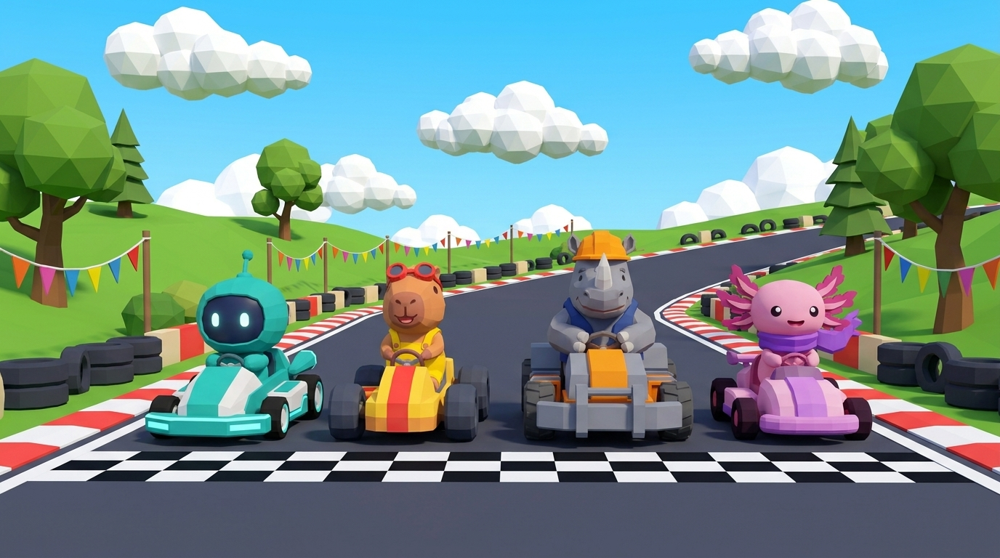

# Turbo Ruedas

Juego de carreras de karts arcade para el navegador, con personajes, pistas y música 100 % originales.
Se juega en la computadora y en el celular, solo o de a dos en pantalla dividida.

**▶ Jugar:** https://lucasderosa-edit.github.io/JuegoKarts/

> El link funciona una vez que GitHub Pages está activado (ver [Publicación](#publicación)).



## Qué tiene

- **8 personajes** con stats distintos (velocidad, aceleración, manejo y peso). Se pueden elegir 4 y los otros 4 corren como rivales:
  - Chispa (carpincho), Tronco (rinoceronte), Pixel (robot) y Brisa (ajolote).
  - Rivales: Coco (tortuga), Rulo (oveja), Mora (rana) y Nube (búho).
- **4 pistas**, cada una con sus obstáculos:

  | Pista | Obstáculos |
  |---|---|
  | Circuito Pradera | La pista para aprender |
  | Costa Coral | Cangrejos que cruzan y olas que barren el muelle |
  | Neón Nocturno | Conos y un colectivo que cruza la esquina |
  | Cumbre Helada | Bolas de nieve gigantes y placas de hielo |

- **Derrape con turbo** de 3 niveles: las chispas pasan de blanco a amarillo y a verde.
- **Ítems:** turbo picante, bola de energía, charco pegajoso y escudo burbuja.
- **7 rivales con IA** que derrapan, buscan cajas y usan ítems.
- **2 jugadores** en pantalla dividida.
- **Récords** por pista guardados en el navegador.
- **Música y efectos generados por código.** No usa archivos de audio.

## Controles

| Acción | Teclado (1 jugador) | Jugador 1 | Jugador 2 | Joystick |
|---|---|---|---|---|
| Acelerar | ↑ o W | W | ↑ | A o RT |
| Frenar / reversa | ↓ o S | S | ↓ | B o LT |
| Doblar | ← → o A D | A D | ← → | Stick o cruceta |
| Derrapar (mantener) | Espacio o Shift | Espacio | Shift der. o - | RB |
| Usar ítem | E, X o Enter | E | Enter o . | X, Y o LB |
| Pausa | Esc o P | Esc | Esc | Start |

En el celular aparecen botones en pantalla. En Opciones se puede activar **Acelerar solo** para manejar con una sola mano.

**Consejos:**
- Acelerá justo cuando la cuenta regresiva está por terminar para salir con turbo.
- Cuanto más largo el derrape, más fuerte el turbo.
- El pasto te frena.

## Desarrollo

Hace falta [Node.js](https://nodejs.org) 20 o más nuevo.

```bash
npm install
npm run dev      # servidor local con recarga automática
npm run build    # genera la versión para publicar en dist/
npm run preview  # prueba la versión de dist/
```

Todos los valores de jugabilidad están en [`src/config.js`](src/config.js): velocidades, derrape, turbo, IA, ítems, cámara, etc.

### Estructura

```
src/
  config.js      valores de jugabilidad
  app.js         flujo del juego: menús, carrera, pausa y resultados
  core/          loop, renderer, teclado, joystick, opciones, récords, calidad gráfica
  kart/          física del kart, modelos 3D del kart y de los personajes, cámara, choques
  track/         pistas (trazado, mallas, decoración y obstáculos)
  ai/            pilotos de la computadora
  items/         cajas e ítems
  race/          reglas de la carrera, vueltas y posiciones
  ui/            HUD, menús, controles táctiles y resultados
  audio/         efectos y música generados con Web Audio
  fx/            partículas
public/assets/   videos e imágenes livianos que usa el juego
referencias/     material original de Google Flow (no se publica con el juego)
```

El plan del proyecto y el estado de cada objetivo están en [PLAN.md](PLAN.md).

## Publicación

El juego se publica solo en GitHub Pages cada vez que se sube algo a `main`, con el workflow [`.github/workflows/deploy.yml`](.github/workflows/deploy.yml).

La primera vez hay que activarlo a mano:

1. En el repositorio, entrá a **Settings → Pages**.
2. En **Build and deployment → Source**, elegí **GitHub Actions**.
3. En la pestaña **Actions**, volvé a correr el workflow **Publicar en GitHub Pages**, o subí cualquier cambio.

Cuando termina, el link aparece en Settings → Pages y en la página del workflow.

## Créditos

- Diseños de personajes, pistas, íconos y videos de menú: generados con Google Flow (Veo 3.1 / Nano Banana) para este proyecto. Los originales están en [`referencias/flow/`](referencias/flow).
- Gráficos 3D: [Three.js](https://threejs.org), con modelos low-poly hechos por código.
- Audio: generado por código con la Web Audio API.
